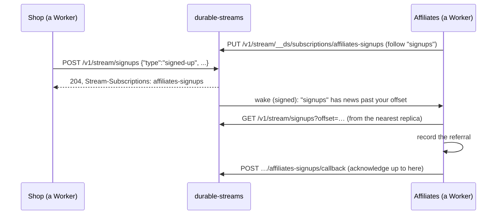

# cloudflare-durable-streams

**[Durable Streams](https://github.com/durable-streams/durable-streams) for Cloudflare: the full
protocol, with subscriptions, on D1 read replicas.** One Worker that any of your Workers, local or
deployed, writes to and follows. Built with [Void](https://void.cloud) and
[Vite+](https://viteplus.dev).

[](https://github.com/joeblew999/cloudflare-durable-streams/actions/workflows/ci.yml)


[](LICENSE)

- **The whole protocol.** Make, append to, read, tail and delete streams; JSON and binary;
  long-poll and SSE; idempotent producers; closing; forks; TTLs. Plus the protocol's
  subscriptions (§6): webhooks with signed wakes, and pull-wake for workers with no public address.
- **Checked by the protocol's own conformance suite:** its authors' 338 tests, and 6 more of this
  repo's for subscriptions, run against the hub itself (`vp run test:conformance`).
- **Global by default.** Every stream is in the hub's D1, with read replication on. A stream is
  read from the replica nearest the Worker reading it, and writes go to the primary. D1
  bookmarks travel with every request, so no client ever reads older than what it has already
  seen or written.
- **For any Worker.** On the same Cloudflare account, through a service binding; from anywhere
  else (local `wrangler dev` or `vp dev`, another account), over HTTPS. Each Worker has an API key of its own.

## Choreography, not orchestration

Most workflow engines have a conductor: one place that knows the steps and tells each service
what to do next. This has none. Each Worker says what happened, as an event on a stream ("signed
up", "paid", "on sale"), and any Worker that cares follows that stream, with a subscription it
makes itself, at runtime. The hub wakes it when there's something new; it reads on from where it
had got to, does its part, maybe publishes what that caused, and acknowledges.

So the workflow is never written down in one place. It's the sum of who follows what, and it
changes when a Worker starts or stops following a stream, with no change to anyone else. Each step
is an activity that a Worker took on for itself. The hub knows no Worker, no stream name and no
step.



Since the events carry what they're part of, the activities can be put back together as they
happen. The example (below) shows each person's actions in an Activity pane: every step, in
whichever Worker it ran, live.

## Deploy it

```sh
git clone https://github.com/joeblew999/cloudflare-durable-streams
cd cloudflare-durable-streams
vp install                                            # Vite+: curl -fsSL https://vite.plus | bash
void cloudflare login                                 # once per machine
echo "ADMIN_EMAILS=you@example.com" > production.env    # who runs this hub; never committed
vp run deploy -- .                                    # the hub
```

`vp run deploy` connects the app to your Cloudflare account, syncs `production.env` as its
secrets, and runs `void deploy`. Void creates what the hub uses (its D1 database with read
replication, and its Durable Objects), applies the database's migrations, and deploys it at
`https://durable-streams.<your-account>.workers.dev`.

**Who may call it is all [Better Auth](https://better-auth.com)** (Void's auth, `auth.ts`):

- the emails in `ADMIN_EMAILS` are the hub's admins, and nobody else can make an account on it;
- streams belong to an **organization**: one hub serves one project, or several kept apart;
- each Worker calls with an **API key** of its own, made in an organization, which can be
  limited, expired and revoked.

A first key, made by an admin (the first call sets that admin's password):

```sh
vp run key -- https://durable-streams.<your-account>.workers.dev you@example.com '<a password>' my-worker
```

Removing it is one command too:

```sh
vp run destroy             # lists every Worker, queue and database this repo deploys
vp run destroy -- --yes    # removes them from Cloudflare; what's in the databases is lost
```

Void deploys, and never removes a direct Cloudflare deployment itself, so `destroy` is Cloudflare's
`wrangler` (a dev dependency here), told the names Void gave things (`scripts/`). Deploy, destroy
and deploy again all work from nothing (done 2026-11-24). Without `-- .`, `vp run deploy` also
deploys the example's two apps after the hub.

Void's `void.lock.json` records what your account has deployed (your database's ID), so it's
yours alone and not in the repo: your first deploy writes it, and `destroy` removes it.

**A Deploy to Cloudflare button is the goal:** one click, and the hub is in your account.
Cloudflare's button deploys from a Wrangler config in the repo, and a Void app writes its own when
it builds, so the button isn't here yet (see Status).

## Use it from your Workers

The hub speaks the protocol at `/v1/stream`, so any Durable Streams client works with it, in any
language. Every request carries a key: `Authorization: Bearer <key>` (or `x-api-key`).

From a Worker, `cloudflare-durable-streams/client` adds what the hub has beyond the protocol: it
keeps the newest D1 bookmark and sends it back, and makes a stream on its first write.

```ts
import { hub } from "cloudflare-durable-streams/client";

// On the same account: a service binding, `{ binding: "HUB", service: "durable-streams" }`.
const streams = hub(env.HUB, env.HUB_KEY);
// Anywhere else, local Workers included: its address.
const remote = hub("https://durable-streams.<your-account>.workers.dev", env.HUB_KEY);

await streams.append("orders/paid", [{ orderId: "o_1", amount: 1200 }]);
const { events, offset } = await streams.read("orders/paid"); // from the start: "-1"
```

Publishing and following, with `cloudflare-durable-streams/bus`:

```ts
import { follower, follows, publisher } from "cloudflare-durable-streams/bus";
import { z } from "zod";

// The shop: what happened.
const publish = publisher(streams);
await publish("orders/paid", "paid", { orderId: "o_1" });

// Another Worker: what it does about it. It subscribes itself, once per run of the Worker,
// giving the address the hub wakes it at.
export const followed = follower({
  hub: streams,
  wakeUrl: "https://emails.example.com/api/hub/wake",
  subscriptions: {
    "emails-orders": follows({
      stream: "orders/paid",
      data: z.object({ orderId: z.string() }),
      title: "Receipt sent",
      description: "Emails a receipt for each paid order",
      work: async ({ orderId }) => sendReceipt(orderId),
    }),
  },
});
// At its wake route: `const wake = await followed.wakeFrom(request)`, then (best from a queue)
// `await followed.deal(wake)`: reads on, does the work for each event, acknowledges.
```

A Worker the hub can't reach (local, behind a firewall) follows with a **pull-wake** subscription
instead, or reads live (`?live=sse` or `long-poll`): it makes the connection, so it needs no
address of its own.

Until the client is on npm, take it from this repo (`client.ts` and `bus.ts`, with
`@durable-streams/client` and `zod`).

## The protocol, at `/v1/stream`

| Request                                                         | What it does                                                      |
| --------------------------------------------------------------- | ----------------------------------------------------------------- |
| `PUT /v1/stream/<path>`                                         | Make a stream (content type, `Stream-TTL`, a fork).               |
| `POST /v1/stream/<path>`                                        | Append (JSON arrays as that many events; producers).              |
| `GET /v1/stream/<path>?offset=-1`                               | Read from an offset, caught up.                                   |
| `GET …?offset=<o>&live=long-poll` / `live=sse`                  | Read live.                                                        |
| `HEAD` / `DELETE /v1/stream/<path>`                             | Where it ends; delete it.                                         |
| `PUT/GET/DELETE /v1/stream/__ds/subscriptions/<id>`             | A subscription: streams by name or pattern, webhook or pull-wake. |
| `POST …/subscriptions/<id>/callback`, `claim`, `ack`, `release` | Acknowledge a wake; a pull-wake worker's lease.                   |
| `GET /v1/stream/__ds/jwks.json`                                 | The keys wakes are signed with.                                   |

Two headers beyond the protocol, which any other client ignores:

- `X-DB-Bookmark`: the newest D1 bookmark, sent and answered (Void's header for it). A request
  that sends one reads from a replica at least that new.
- `Stream-Subscriptions`, on a write's answer: the subscriptions it woke. The example's control
  plane uses it to show each follower's part as a step of the action that published.

## How it works

The hub is a [Void](https://void.cloud) app at this repo's root:

| Where                                 | What                                                                                     |
| ------------------------------------- | ---------------------------------------------------------------------------------------- |
| `routes/v1/stream/[...path].ts`       | The protocol: every request under `/v1/stream`.                                          |
| `src/server/d1/`                      | Durable Streams on D1: the server, its store, the live-read notifier.                    |
| `src/server/`                         | The protocol's subscriptions: wakes, leases, the directory of who follows what, signing. |
| `durable-objects/`                    | The subscriptions, the directory, the signing key, and a notifier per stream.            |
| `db/`                                 | The streams' tables and their migration.                                                 |
| `auth.ts`, `middleware/01.callers.ts` | Who may call, all Better Auth's: admins, organizations, an API key per Worker.           |
| `crons/daily.ts`                      | Wakes any subscriber left behind; removes expired streams.                               |
| `client.ts`, `bus.ts`                 | For your Workers: the client, and publishing and following.                              |
| `test/`                               | The protocol's conformance suite, and the subscription tests, against the hub.           |
| `examples/`                           | The example: a shop and an affiliate service, choreographed over the hub.                |
| `plans/`                              | The plans it was built to, by date.                                                      |

- **Reads** go through a D1 session (Void's `createDb` with a session): the nearest replica that
  has caught up to the request's bookmark. A read for an offset its replica hasn't reached yet
  (one a newer write gave out) is read again from the primary.
- **Writes** go to the primary, each as one D1 batch, applied whole and only if the stream is
  still as the writer read it. A write overtaken by another reads again and tries again. There's
  no lock, and no Durable Object in the write path, so any of the hub's Workers takes any write.
- **Live reads** wait on a notifier, one small Durable Object per stream that holds no data. A
  write tells it where the stream now ends, with the write's bookmark; a waiting reader then reads
  from its own replica from that bookmark. A notice lost to a restart only delays a reader, which
  looks again when its wait runs out.
- **Subscriptions** are Durable Objects of their own: what each follows, how far it has
  acknowledged, and its wake (a lease, sent again if it runs out; a failed delivery tried again
  with backoff). Wakes are signed (Ed25519, the protocol's webhooks); a subscriber checks them
  against `/__ds/jwks.json`.
- **The cost of global reads:** every stream's writes go to one D1 primary. For event traffic
  between Workers that's plenty; where one stream takes thousands of writes a second, it isn't.

The protocol logic is ported from
[`@durable-streams/server-cloudflare`](https://github.com/durable-streams/durable-streams/tree/main/packages/server-cloudflare),
which keeps each stream in a Durable Object of its own (Apache-2.0: `NOTICE`).

## Develop

```sh
curl -fsSL https://vite.plus | bash   # Vite+ (vp), once per machine
vp env on                             # the Node in .node-version
vp install
vp run setup                          # the hub's admin and database, and the example's, with its keys
vp dev                                # the hub on http://localhost:5175/v1/stream
```

- `vp check` formats, lints and type-checks; `vp run check:types` type-checks every project.
- `vp run test:conformance` runs the protocol's conformance suite and the subscription tests
  against the hub under `vp dev` (about a minute).
- Every task is in `vite.config.ts`, each with a line saying what it does.

**Measuring it around the world:**
[cloudflare-ping](https://github.com/joeblew999/cloudflare-ping) runs probes from Cloudflare's
own data centres. It's how the hub's reads from the nearest replica, and its wakes, will be timed
from everywhere.

## The example

[`examples/`](examples/README.md): an affiliate program for a shop. A shop and an affiliate service
(two Void apps) never call each other for what happens: sign-ups, Stripe's payments, events going
on sale. They publish it to the hub and follow it there, and an Activity pane on every page shows
each action's steps across both, live. It's a work in progress, with its own tests (`vp run
test:dev`); the hub's correctness is the conformance suite's, not the example's.

## Status

- The hub, its protocol and its subscriptions: done, and all 344 conformance tests pass.
- Deployed, used, removed and deployed again with `vp run deploy` and `vp run destroy`. The
  **Deploy to Cloudflare** button: to come.
- The client on npm: to come; until then it's `client.ts` and `bus.ts` here.
- Timing it from around the world with cloudflare-ping: to come.
- A stream only grows. For long-lived ones (a control plane's), streams by day, each with a
  `Stream-TTL`, are the plan.

## License

MIT (`LICENSE`). The protocol logic ported from `@durable-streams/server-cloudflare` stays under
its Apache-2.0 licence (`NOTICE`, `LICENSE-durable-streams-server-cloudflare`).
